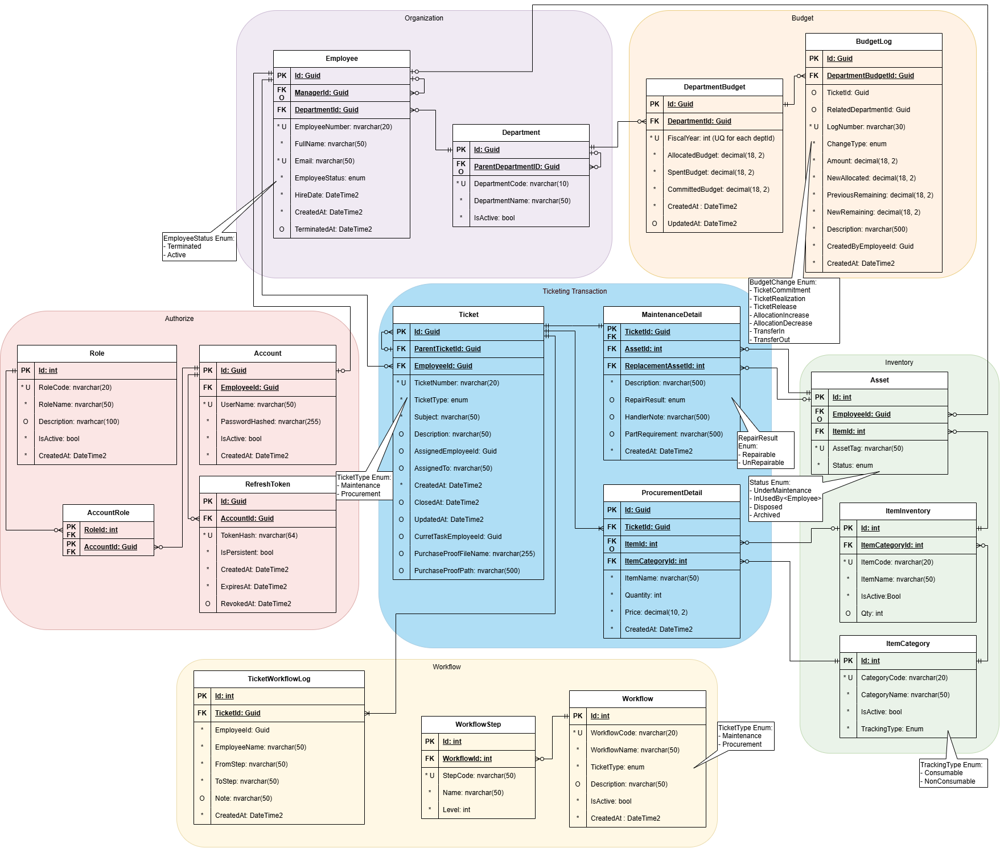
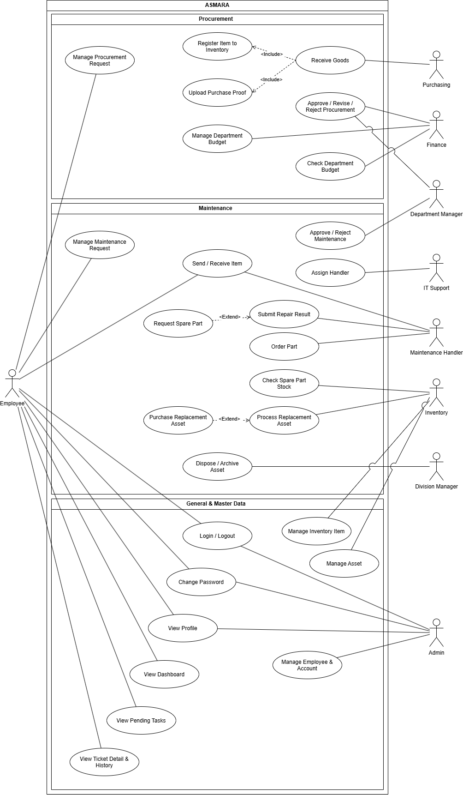

# ASMARA API

**ASMARA** (*Ticketing System for Procurement and Maintenance*) adalah layanan backend berbasis **ASP.NET Core (.NET 10)** untuk mengelola pengajuan pengadaan barang (*Procurement*), perawatan & perbaikan aset (*Maintenance*), manajemen inventaris & aset fisik, pengendalian anggaran departemen (*Finance*), serta alur persetujuan berjenjang (*multi-level approval workflow*).


---

## ✨ Fitur Utama

- **Procurement Workflow:** Pengajuan pengadaan barang dengan persetujuan berjenjang (`Department Approval` → `Finance Approval` → `Purchasing`), dukungan revisi/resubmit, pembatalan tiket, serta unggah bukti pembelian (*purchase proof*) saat penerimaan barang (`receive-goods`).
- **Maintenance Workflow:** Pelaporan kerusakan aset yang terintegrasi dengan siklus perbaikan teknisi (`Assign Handler` → `Send/Receive Unit` → `Repair Result`):
  - **Repaired:** Pengembalian unit ke pemohon dan pelepasan status aset.
  - **Need Part:** Pengecekan stok suku cadang (*Consumable*) di gudang Inventory (`INVENTORY_PART_CHECK`) terlebih dahulu sebelum membuat *Child Procurement Ticket* (`OrderPart`) jika stok kosong.
  - **Unrepairable:** Pengajuan peninjauan Division Manager (`Dispose` / `Archive`) hingga proses penggantian unit aset (*Replacement* dari stok tersedia atau pengadaan unit baru).
- **Inventory & Asset Management:**
  - Pemisahan kategori **Consumable** (berbasis kuantitas stok) dan **Non-Consumable** (pelacakan unit individual dengan `AssetTag` seperti `AST-XXXXXX`).
  - Endpoint khusus `/api/inventory/spare-parts` untuk pengecekan stok suku cadang secara langsung.
- **Finance & Department Budgeting:**
  - Manajemen pagu anggaran per departemen per tahun fiskal (`Allocated`, `Committed`, `Spent`, `Remaining`).
  - Pengikatan komitmen anggaran otomatis saat Finance menyetujui Procurement dan realisasi saat barang diterima Purchasing, lengkap dengan pencatatan audit pada `BudgetLog`.
- **Dashboard & Pending Tasks:** Statistik tiket pribadi/bawahan, riwayat aktivitas, dan daftar tugas tertunda sesuai peran pengguna.
- **Authentication & RBAC:** Autentikasi JWT Bearer + Refresh Token dengan manajemen akun dan peran berbasis level hierarki organisasi.
- **Asynchronous Background Email:** Pengiriman notifikasi email via SMTP (MailKit) diproses di latar belakang menggunakan *Bounded Channel Queue* (`EmailBackgroundWorker`) agar respons API tetap cepat.

---

## 🛠️ Tech Stack

| Kategori | Teknologi / Library |
|---|---|
| **Framework** | ASP.NET Core Web API (`.NET 10.0`) |
| **Database & ORM** | Microsoft SQL Server + Entity Framework Core `10.0.13` |
| **Architecture & Pattern** | Vertical Slice (`Features/`), CQRS dengan `MediatR`, Repository & `IUnitOfWork` |
| **Workflow Engine** | Custom State Machine (`TransitionMap`, `TicketFlowService`, `ApproverResolver`) |
| **Validation** | `FluentValidation` |
| **Auth & Security** | JWT Bearer (`Microsoft.AspNetCore.Authentication.JwtBearer`) + Refresh Token |
| **Email Notification** | `MailKit` + `System.Threading.Channels` (`BackgroundService`) |
| **Logging & API Docs** | `Serilog` (Console & Rolling File), OpenAPI + `Swashbuckle.AspNetCore.SwaggerUI` |

---

## 👥 Role Pengguna

| Kode Role | Peran | Tanggung Jawab Utama |
|---|---|---|
| `ROL-01` | **Employee** | Mengajukan tiket Procurement / Maintenance & menerima/menutup tiket |
| `ROL-02` | **Department Manager** | Menyetujui, meminta revisi, atau menolak tiket departemen |
| `ROL-03` | **Division Manager** | Approval tingkat divisi & keputusan `Dispose` / `Archive` aset rusak total |
| `ROL-04` | **Finance** | Approval anggaran Procurement & pengelolaan `DepartmentBudget` |
| `ROL-05` | **Purchasing** | Eksekusi pembelian barang & konfirmasi barang masuk (`receive-goods`) |
| `ROL-06` | **Inventory** | Kelola master barang/aset, cek ketersediaan spare part & aset pengganti |
| `ROL-07` | **IT Support** | Meninjau tiket Maintenance & menugaskan teknisi (`AssignHandler`) |
| `ROL-08` | **Maintenance Handler** | Menangani perbaikan unit, submit `repair-result`, & mengajukan `order-part` |
| `ROL-09` | **Admin** | Manajemen master karyawan, akun, departemen, & sistem |

---

## 📐 Dokumentasi & Diagram Sistem

Dokumentasi desain sistem tersimpan di folder [`docs/`](./docs):

- **Use Case Diagram:** [`docs/AsmaraUseCase.drawio.png`](./docs/AsmaraUseCase.drawio.png)
- **Entity Relationship Diagram (ERD):** [`docs/AsmaraERD.drawio.png`](./docs/AsmaraERD.drawio.png)
- **Business Process (BPMN):** [`docs/AsmaraBPMN.bpmn`](./docs/AsmaraBPMN.bpmn)
- **Activity Diagram:** [`docs/ASMARA_ActivityDiagram.drawio`](./docs/ASMARA_ActivityDiagram.drawio)

<details>
<summary>Lihat Preview ERD & Use Case</summary>




</details>

---

## 📂 Struktur Proyek

```text
ASMARA/
├── docs/                               # Diagram ERD, Use Case, BPMN, & Activity
├── ASMARA.slnx                         # Solution file
└── ASMARA.API/
    ├── Common/                         # Exception handlers, Paging, Security (JWT, Roles)
    ├── Controllers/                    # REST API Controllers
    ├── Data/                           # AsmaraDbContext, Repositories, Seeder & SQL scripts
    ├── Entities/                       # Database Entity models
    ├── Enums/                          # Domain enums (TicketType, TicketAction, BudgetChangeType, dll.)
    ├── Extensions/                     # Registrasi DI Services, Mediator, Security, OpenAPI
    ├── Features/                       # Vertical slices (Commands, Queries, Validators, Events)
    ├── Middlewares/                    # CorrelationId, Logging, MaintenanceMode
    ├── Models/                         # Request & Response DTOs
    ├── OpenApi/                        # Transformer dokumentasi OpenAPI / Swagger
    ├── Services/                       # Email Queue & Worker, File Storage, TicketFlow Engine
    └── Program.cs                      # Entry point & middleware pipeline
```

---

## 🚀 Cara Menjalankan (Local Setup)

### 1. Prasyarat
- [.NET 10 SDK](https://dotnet.microsoft.com/download)
- Microsoft SQL Server (atau SQL Server Express / LocalDB)
- (Opsional) SMTP server lokal untuk testing email (misal Mailpit / Papercut SMTP di port `25` atau konfigurasi Mailtrap)

### 2. Clone Repository
```bash
git clone <url-repository-anda>
cd ASMARA
```

### 3. Konfigurasi Database & Secrets
Sesuaikan connection string di `ASMARA.API/appsettings.json` (atau gunakan `dotnet user-secrets` untuk data sensitif):

```json
"ConnectionStrings": {
  "AsmaraDB": "Server=localhost;Database=AsmaraDB;Trusted_Connection=True;TrustServerCertificate=True"
}
```

Atur secret key JWT (minimal 32 karakter) dan kredensial email via User Secrets pada folder `ASMARA.API`:
```bash
cd ASMARA.API
dotnet user-secrets set "Jwt:SecretKey" "your-super-secret-key-at-least-32-characters"
dotnet user-secrets set "EmailSettings:Host" "localhost"
dotnet user-secrets set "EmailSettings:Port" "25"
```

### 4. Seeding Data Awal
- Pada environment `Development`, aplikasi otomatis menjalankan `DevelopmentDataSeeder` saat startup (membuat data kategori, inventaris, termasuk spare part consumable, dan aset contoh jika data karyawan sudah tersedia).
- Untuk inisialisasi pagu anggaran Finance (`DepartmentBudget` & `BudgetLog`), jalankan script SQL berikut di SSMS:
  - [`ASMARA.API/Data/Finance_Seed.sql`](./ASMARA.API/Data/Finance_Seed.sql)

### 5. Jalankan Aplikasi
```bash
dotnet restore
dotnet run --project ASMARA.API
```

Setelah berjalan, buka **Swagger UI** melalui browser:
- HTTPS: `https://localhost:7087/swagger`
- HTTP: `http://localhost:5243/swagger`

---

## 📡 Ringkasan Endpoint API

| Modul | Base Route | Keterangan |
|---|---|---|
| **Auth** | `/api/auth` | Login, refresh token, logout |
| **Profile & Account** | `/api/profile`, `/api/account` | Profil pengguna aktif & manajemen akun |
| **Employees & Organization** | `/api/employees`, `/api/departments`, `/api/roles` | Data karyawan, departemen, & role |
| **Dashboard** | `/api/dashboard` | Statistik tiket & daftar aktivitas terbaru |
| **Tickets (Umum)** | `/api/tickets` | Daftar tiket, detail tiket, riwayat, & pending tasks |
| **Procurement** | `/api/procurements` | Buat pengadaan, approve/revise/reject, resubmit, receive-goods |
| **Maintenance** | `/api/maintenances` | Buat tiket perawatan, assign handler, repair result, part check, order part, replacement |
| **Inventory & Assets** | `/api/inventory`, `/api/assets` | Master barang, kategori, spare parts (`/spare-parts`), unit aset & mutasi |
| **Finance** | `/api/finance` | Overview anggaran, budget per departemen, adjust/transfer budget, budget logs |

---

## 👨‍💻 Tim Pengembang

- **Mu'aafii Putra Ramadhan** 
- **Fran Dello** 
- - **Muhammad Bagas Ruliansyah** 
